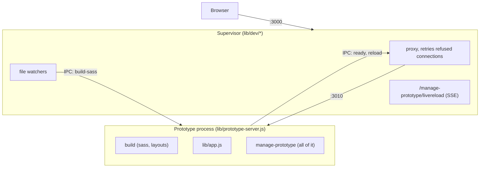

# Plan: small supervisor, manage prototype in one process

## Goal

Replace the current 3-way split of manage prototype with:

- a **small supervisor** (dev only) that holds the port, proxies every request,
  watches files, restarts the prototype process and hosts live reload
- a **prototype process** that serves the prototype and *all* of manage
  prototype, and is the same code `protato start` runs in production

The aim is less code and fewer moving parts. When choosing between two ways to
do something, pick the one that deletes more.

## Why

Today the split of manage prototype exists only because some of the manage UI
lives in the dev process, which survives restarts, and some has to live in the
prototype process, because it needs the session or the prototype's views:

| piece | file | lives in |
|---|---|---|
| session app (password, clear-data) | `manage-prototype/apps/session-app.js` | prototype process |
| dev app (home, templates, plugins, livereload) | `manage-prototype/apps/dev-app.js` | dev process |
| template preview | `manage-prototype/routes/preview.js` | prototype process |

That causes `proxyPaths`, `base-app.js`, the ordering rules in
`lib/dev/server.js`, the build result being sent over IPC, and
`lib/manage-plugins/change.js` importing the supervisor.

Only two things really need to survive a restart: **the port**, and **the
browser's next request after a plugin change**. The supervisor handles both,
without knowing anything about manage prototype.

## Target architecture



### The supervisor's rules (the guard against it growing)

1. It imports only `node:*` modules, `chokidar`, `radash` and other files in
   `lib/dev/`. **Nothing** from `lib/app.js`, `lib/build.js`, `lib/plugins.js`,
   `lib/manage-plugins/*` or `manage-prototype/*`. Add a unit test that checks
   this, by reading the import statements of the files in `lib/dev/`.
2. It has no Express app. Plain `node:http`.
3. The only HTTP route it handles itself is `GET /manage-prototype/livereload`.
   Everything else goes to the child.

### Responsibilities

**Supervisor** (`lib/dev/`)

- `server.js`: `http.createServer` on the port the browser uses. Serves
  livereload, and sends everything else to the proxy.
- `proxy.js`: sends requests to the child. A refused connection means the
  child is not listening yet, and never reached it, so retry until a deadline
  (2 minutes, because a restart can wait for npm to finish a plugin change).
  This is safe for any method, including POST. A connection that was made and
  then failed might have reached the child, so only GET and HEAD are retried in
  that case. When the deadline passes, respond 503: "The prototype did not
  start, check the terminal". If the supervisor knows the child crashed, fail
  waiting requests at once instead of retrying.
- `supervisor.js`: fork, stop and restart the child (keep the existing
  coalescing in `restartPrototypeServer`). It no longer sends a build result or
  tracks readiness. Messages it handles:
  - `ready`: resolves the start promise
  - `reload`: reload the browser
  - unexpected exit (crash): log it and mark the child as down. The proxy fails
    requests straight away. The next file change restarts the child.
- `watch.js`: the same watchers as now, but they never build:
  - backend (`app/**/*.js|json`, `.env`) → restart
  - lockfile → restart (this replaces `rebuildAndRestart`: a new process
    clears the plugin cache and rebuilds itself)
  - sass → send `{ action: 'build-sass' }` to the child (see below)
  - frontend (public, views, assets) → `livereload.reload()`
  - after any restart → `livereload.reload()`
- `livereload.js`: unchanged. It now lives in the process that survives
  restarts, so browsers stay connected.

**Prototype process** (`lib/prototype-server.js`)

- Runs `buildPrototype()` itself at startup, in dev and production. Drop
  passing `buildResult` over IPC.
- Listens on the port it is given and, when forked, gets that port from
  `PROTATO_PROTOTYPE_PORT` in its environment and starts as soon as it runs. It
  sends `ready` once it is listening.
- A plugin change runs npm in this process. While it is running, the child
  refuses to force-exit, so `server.close()` can wait for the npm request and
  the result page to finish before the process exits. The supervisor does not
  need to know that a plugin change is happening.
- In dev, starts `registry.startFetchingPluginData()` (moved from
  `lib/start.js`).
- **Sass errors without a restart**: decide per request whether to show the
  build error, instead of choosing an error app once at startup:

  ```js
  const server = http.createServer((req, res) => {
    const handler = getBuildResult().state === 'error' ? errorApp : app
    handler(req, res)
  })
  ```

  On `build-sass` it calls `buildSass()`. The supervisor does not need an
  answer: the frontend watcher sees the new css and reloads, and on an error
  the next request shows the error page. If the reload does not happen for a
  sass error (no css written), have the child send `{ type: 'reload' }` after
  building and the supervisor call `livereload.reload()`.
- A startup error in `app.js` (user routes) still falls back to the error app,
  as now.

**manage prototype** (`manage-prototype/`)

One router, mounted at `/manage-prototype` by `lib/app.js` and by the error
app. Suggested layout:

```
manage-prototype/
  index.js          getManagePrototypeApp({ env }) – the only export lib/ uses
  nunjucks.js
  csrf.js
  routes/
    session.js      password, clear-data (was apps/session-app.js)
    templates.js    templates list, create, created, and preview
    plugins.js
```

- `index.js` builds one Express sub-app: the manage nunjucks env, static
  assets, csrf, then the routes. Production gets only `session.js`. Development
  also gets home, templates (including preview) and plugins.
- **Template preview** needs the *prototype's* nunjucks env (user filters,
  plugin views), not the manage env. Keep it as a route that calls
  `response.render`, but register it on the prototype app in `lib/app.js` (as
  now), or have it render with `request.app.parent`'s env. Choose whichever is
  smaller; the point is that it no longer needs a proxy path.
- Delete `apps/base-app.js`, `apps/dev-app.js`, `apps/session-app.js`,
  `routes/preview.js` (merge into `templates.js` if preview stays a
  manage-prototype route), and `proxyPaths`.
- csrf: keep `csrf-csrf` as it is. It works with or without a session, so it
  does not need changing. Body parsing is already done by `lib/app.js` before
  manage prototype is mounted; don't parse twice.

**Plugin changes** (`lib/manage-plugins/change.js`, `routes/plugins.js`)

Today a POST runs npm, rebuilds, waits for the restart, then renders the
result. New flow:

1. `POST /manage-prototype/plugins/install` (or uninstall, update)
2. The child runs npm. It tracks that a change is running, so its `stop()` does
   not force-exit while npm is still going. `server.close()` already waits for
   the POST request that started the change, so the result page is sent before
   the process exits.
3. It renders `plugin-result` from the POST response, as it does today. The
   process that ran the change knows what happened, so the result does not need
   a new process or a redirect.
4. The supervisor restarts on its own: npm writes `package-lock.json`, and the
   lockfile watcher asks for a restart. The restart does not kill npm, because
   the child waits for the change before exiting. If npm failed and nothing
   changed, there is no restart.
5. Requests made while the restart runs retry until the new process is
   listening, so the user's next click simply waits.

`change.js` no longer imports `supervisor.js`, calls `buildPrototype()` or sends
`change-start` / `change-end` messages. It exports `isChangeRunning()` only so
the prototype server's `stop()` can tell whether npm is still running.

The result page must not reload itself: the supervisor sends a livereload
message after the restart, which on a page with a form could submit it again.
Manage pages do not load the livereload script (only
`manage-prototype/views/server-error.njk` and `plugin/assets/javascripts/kit.js`
do), so this holds as long as the result page stays a manage page.

**`lib/start.js`**

```js
if (isDev) {
  await supervisor.startPrototypeServer(port + 10)   // resolves on 'ready'
  devServer.start({ port })
  watch()
} else {
  await prototypeServer.start({ port })
}
```

Start the dev server first if that is simpler: retrying makes the order
irrelevant.

## Steps

Do these in order. Keep `npm test` passing after each step, and commit after
each.

1. **Retrying proxy** in `lib/dev/proxy.js`, with unit tests: a request while
   the child is not listening retries and then succeeds; it times out with a
   503; a refused POST is retried; a reset connection is retried only for GET
   or HEAD.
2. **Child builds itself.** Move `buildPrototype()` into
   `prototype-server.js` startup, delete the IPC `buildResult`, add the
   per-request build-error switch and the `build-sass` message. The sass
   watcher sends the message instead of building.
3. **Child owns plugin-change shutdown.** Remove `change-start` / `change-end`
   and the supervisor's change hold. The prototype process refuses to
   force-exit while a change is running, and the supervisor waits for it to
   exit.
4. **Plugin flow renders the result directly**, with no response-sent IPC.
   Update `tests/plugin-management.test.js`: install from the UI, check that
   the result page shows and that the plugin's assets are served (proving the
   restart happened).
5. **Move livereload and the dev manage UI.** Livereload goes on the
   supervisor's plain http server. The manage UI moves into the prototype
   process as the single `manage-prototype/index.js` router. Delete
   `proxyPaths`, `base-app.js`, `dev-app.js`, `session-app.js` and the Express
   app in `lib/dev/server.js`.
6. **Supervisor import guard** test (rule 1 above).
7. **Tidy up**: update the comments at the top of `manage-prototype/index.js`,
   `lib/dev/*.js` and `lib/prototype-server.js` to describe the new structure.
   Remove tests for deleted modules. Run `npm run lint:fix`.

## Acceptance criteria

- `npm test` passes (unit, end-to-end and lint).
- `grep -rn proxyPaths lib manage-prototype` finds nothing.
- `lib/dev/` imports nothing outside `lib/dev/` except `node:*`, `chokidar` and
  `radash` (checked by a test).
- Manually, in `starter/` with `npm run dev`:
  - edit `app/routes.js`: the browser reloads, and no request fails during the
    restart
  - break `app/routes.js` (syntax error): the error page shows and
    `/manage-prototype/plugins` still works
  - break a sass file: the error page shows with no restart. Fix it: the page
    reloads
  - install and uninstall a plugin from the plugins page: the result page
    shows, and the plugin's styles/templates are there or gone
  - `npm install <plugin>` in a terminal: the prototype restarts and picks it up
  - kill the child (`kill <pid>`): requests get the 503 message straight away,
    and the next file change brings it back
- `protato start` (production) works, and the plugins and templates pages 404.

## Out of scope

- Changing what the manage pages look like or do.
- Hot reloading in one process (the ESM module cache makes this impractical).
- Saving registry plugin data to disk. It is fetched again on each restart,
  which is acceptable because the fetch doesn't block startup. Note it as a
  possible follow-up if "update available" visibly flickers.

## Open questions for the human

- Should template preview stay a route in `lib/app.js`, or become a
  manage-prototype route that renders with the prototype's env? It stayed in
  `lib/app.js` (handler in `manage-prototype/routes/templates.js`), because the
  alternative needs `request.app.parent`'s Nunjucks env.
- The retry deadline and the 503 wording. The deadline is now 2 minutes, because
  a restart can wait for npm to finish a plugin change.
