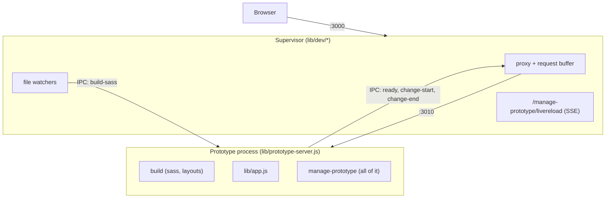

# Plan: small supervisor, manage prototype in one process

## Goal

Replace the current 3-way split of manage prototype with:

- a **small supervisor** (dev only) that holds the port, proxies every request,
  watches files, restarts the prototype process and hosts live reload
- a **prototype process** that serves the prototype and *all* of manage
  prototype, and is the same code `protato start` runs in production

The aim is less code and fewer moving parts. When choosing between two ways to
do something, pick the one that deletes more.

## Why

Today the split of manage prototype exists only because some of the manage UI
lives in the dev process, which survives restarts, and some has to live in the
prototype process, because it needs the session or the prototype's views:

| piece | file | lives in |
|---|---|---|
| session app (password, clear-data) | `manage-prototype/apps/session-app.js` | prototype process |
| dev app (home, templates, plugins, livereload) | `manage-prototype/apps/dev-app.js` | dev process |
| template preview | `manage-prototype/routes/preview.js` | prototype process |

That causes `proxyPaths`, `base-app.js`, the ordering rules in
`lib/dev/server.js`, the build result being sent over IPC, and
`lib/manage-plugins/change.js` importing the supervisor.

Only two things really need to survive a restart: **the port**, and **the
browser's next request after a plugin change**. The supervisor handles both,
without knowing anything about manage prototype.

## Target architecture



### The supervisor's rules (the guard against it growing)

1. It imports only `node:*` modules, `chokidar`, `radash` and other files in
   `lib/dev/`. **Nothing** from `lib/app.js`, `lib/build.js`, `lib/plugins.js`,
   `lib/manage-plugins/*` or `manage-prototype/*`. Add a unit test that checks
   this, by reading the import statements of the files in `lib/dev/`.
2. It has no Express app. Plain `node:http`.
3. The only HTTP route it handles itself is `GET /manage-prototype/livereload`.
   Everything else goes to the child.

### Responsibilities

**Supervisor** (`lib/dev/`)

- `server.js`: `http.createServer` on the port the browser uses. Serves
  livereload, and sends everything else to the proxy.
- `proxy.js`: the existing proxy, plus:
  - **buffering**: while the child is not ready (starting or restarting),
    requests wait in a queue and are replayed when the child sends `ready`.
    Cap the wait (for example 30s), then respond 503 with a short plain-text or
    static HTML message: "The prototype did not start, check the terminal".
  - **restart header**: if a child response has `x-protato-restart: 1`,
    remove that header, mark the child as not ready (so requests start
    buffering) and start a restart *before* sending the response to the
    browser. This makes sure the browser's follow-up request lands on the new
    process.
- `supervisor.js`: fork, stop and restart the child (keep the existing
  coalescing in `restartPrototypeServer`). It no longer sends a build result.
  Messages it handles:
  - `ready`: flush the request buffer
  - `change-start` / `change-end`: while a plugin change is running, **hold
    every restart** (from watchers too) and run one restart afterwards if any
    were asked for. Otherwise the lockfile watcher would kill the child, and
    the npm process it is running, part way through an install.
  - unexpected exit (crash): log it and stay "not ready". Requests get the 503
    message once they time out. The next file change restarts the child.
- `watch.js`: the same watchers as now, but they never build:
  - backend (`app/**/*.js|json`, `.env`) → restart
  - lockfile → restart (this replaces `rebuildAndRestart`: a new process
    clears the plugin cache and rebuilds itself)
  - sass → send `{ action: 'build-sass' }` to the child (see below)
  - frontend (public, views, assets) → `livereload.reload()`
  - after any restart → `livereload.reload()`
- `livereload.js`: unchanged. It now lives in the process that survives
  restarts, so browsers stay connected.

**Prototype process** (`lib/prototype-server.js`)

- Runs `buildPrototype()` itself at startup, in dev and production. Drop
  passing `buildResult` over IPC.
- Listens on the port it is given and, when forked, sends `ready` once it is
  listening.
- In dev, starts `registry.startFetchingPluginData()` (moved from
  `lib/start.js`).
- **Sass errors without a restart**: decide per request whether to show the
  build error, instead of choosing an error app once at startup:

  ```js
  const server = http.createServer((req, res) => {
    const handler = getBuildResult().state === 'error' ? errorApp : app
    handler(req, res)
  })
  ```

  On `build-sass` it calls `buildSass()`. The supervisor does not need an
  answer: the frontend watcher sees the new css and reloads, and on an error
  the next request shows the error page. If the reload does not happen for a
  sass error (no css written), have the child send `{ type: 'reload' }` after
  building and the supervisor call `livereload.reload()`.
- A startup error in `app.js` (user routes) still falls back to the error app,
  as now.

**manage prototype** (`manage-prototype/`)

One router, mounted at `/manage-prototype` by `lib/app.js` and by the error
app. Suggested layout:

```
manage-prototype/
  index.js          getManagePrototypeApp({ env }) – the only export lib/ uses
  nunjucks.js
  csrf.js
  routes/
    session.js      password, clear-data (was apps/session-app.js)
    templates.js    templates list, create, created, and preview
    plugins.js
```

- `index.js` builds one Express sub-app: the manage nunjucks env, static
  assets, csrf, then the routes. Production gets only `session.js`. Development
  also gets home, templates (including preview) and plugins.
- **Template preview** needs the *prototype's* nunjucks env (user filters,
  plugin views), not the manage env. Keep it as a route that calls
  `response.render`, but register it on the prototype app in `lib/app.js` (as
  now), or have it render with `request.app.parent`'s env. Choose whichever is
  smaller; the point is that it no longer needs a proxy path.
- Delete `apps/base-app.js`, `apps/dev-app.js`, `apps/session-app.js`,
  `routes/preview.js` (merge into `templates.js` if preview stays a
  manage-prototype route), and `proxyPaths`.
- csrf: keep `csrf-csrf` as it is. It works with or without a session, so it
  does not need changing. Body parsing is already done by `lib/app.js` before
  manage prototype is mounted; don't parse twice.

**Plugin changes** (`lib/manage-plugins/change.js`, `routes/plugins.js`)

Today a POST runs npm, rebuilds, waits for the restart, then renders the
result. New flow, using post/redirect/get:

1. `POST /manage-prototype/plugins/install` (or uninstall, update)
2. The child sends `change-start` over IPC, runs npm, then sends `change-end`.
   Use `try/finally` so `change-end` is always sent.
3. It stores the result in the session, for example
   `request.session.pluginResult = result`. The file session store survives
   restarts.
4. It responds `303 Location: /manage-prototype/plugins/result` with
   `x-protato-restart: 1`, but only if npm changed something (outcome `ok`).
   For `busy` or `failed`, redirect without the header.
5. The supervisor starts the restart before forwarding the 303. The browser's
   `GET /manage-prototype/plugins/result` is buffered until the new child is
   ready.
6. The new child renders `plugin-result` from `request.session.pluginResult`
   and then deletes it. If there is no result, redirect to `/manage-prototype/plugins`.

`change.js` no longer imports `supervisor.js` or calls `buildPrototype()`. Delete
`rebuildAndRestart` and `isChangeRunning` (the supervisor's change hold replaces
it). The IPC sends must do nothing when `process.send` is undefined (tests,
production).

Step 6 works because sessions survive restarts. `lib/middleware/session.js`
uses a fixed secret and the file store. Keep it that way: a secret generated
at startup would break this flow.

**`lib/start.js`**

```js
if (isDev) {
  await supervisor.startPrototypeServer(port + 10)   // resolves on 'ready'
  devServer.start({ port })
  watch()
} else {
  await prototypeServer.start({ port })
}
```

Start the dev server first if that is simpler: buffering makes the order
irrelevant.

## Steps

Do these in order. Keep `npm test` passing after each step, and commit after
each.

1. **Buffering proxy and restart header** in `lib/dev/proxy.js`, with unit
   tests: a request while not ready waits and then succeeds; it times out with
   a 503; a response with `x-protato-restart` calls a restart callback before
   the response is sent, and the header is not passed on.
2. **Child builds itself.** Move `buildPrototype()` into
   `prototype-server.js` startup, delete the IPC `buildResult`, add the
   per-request build-error switch and the `build-sass` message. The sass
   watcher sends the message instead of building.
3. **Change hold in the supervisor** (`change-start` / `change-end`), with
   unit tests showing that restarts asked for during a change run once after
   `change-end`.
4. **Plugin flow to post/redirect/get** as above. Update
   `tests/plugin-management.test.js`: install from the UI, follow the redirect,
   check that the result page shows and that the plugin's assets are served
   (proving the restart happened).
5. **Move livereload and the dev manage UI.** Livereload goes on the
   supervisor's plain http server. The manage UI moves into the prototype
   process as the single `manage-prototype/index.js` router. Delete
   `proxyPaths`, `base-app.js`, `dev-app.js`, `session-app.js` and the Express
   app in `lib/dev/server.js`.
6. **Supervisor import guard** test (rule 1 above).
7. **Tidy up**: update the comments at the top of `manage-prototype/index.js`,
   `lib/dev/*.js` and `lib/prototype-server.js` to describe the new structure.
   Remove tests for deleted modules. Run `npm run lint:fix`.

## Acceptance criteria

- `npm test` passes (unit, end-to-end and lint).
- `grep -rn proxyPaths lib manage-prototype` finds nothing.
- `lib/dev/` imports nothing outside `lib/dev/` except `node:*`, `chokidar` and
  `radash` (checked by a test).
- Manually, in `starter/` with `npm run dev`:
  - edit `app/routes.js`: the browser reloads, and no request fails during the
    restart
  - break `app/routes.js` (syntax error): the error page shows and
    `/manage-prototype/plugins` still works
  - break a sass file: the error page shows with no restart. Fix it: the page
    reloads
  - install and uninstall a plugin from the plugins page: the result page
    shows, and the plugin's styles/templates are there or gone
  - `npm install <plugin>` in a terminal: the prototype restarts and picks it up
  - kill the child (`kill <pid>`): requests get the 503 message after the
    timeout, and the next file change brings it back
- `protato start` (production) works, and the plugins and templates pages 404.

## Out of scope

- Changing what the manage pages look like or do.
- Hot reloading in one process (the ESM module cache makes this impractical).
- Saving registry plugin data to disk. It is fetched again on each restart,
  which is acceptable because the fetch doesn't block startup. Note it as a
  possible follow-up if "update available" visibly flickers.

## Open questions for the human

- Should template preview stay a route in `lib/app.js`, or become a
  manage-prototype route that renders with the prototype's env? Pick the
  smaller diff and note why.
- The buffer timeout (30s suggested) and the 503 wording.
